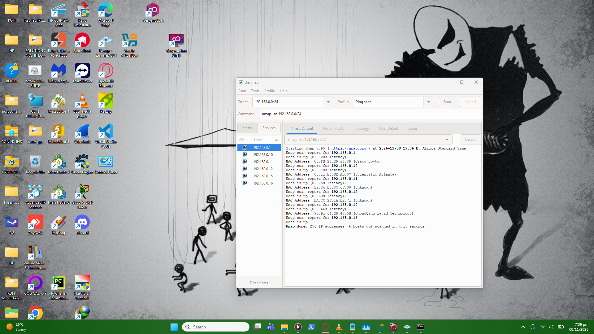
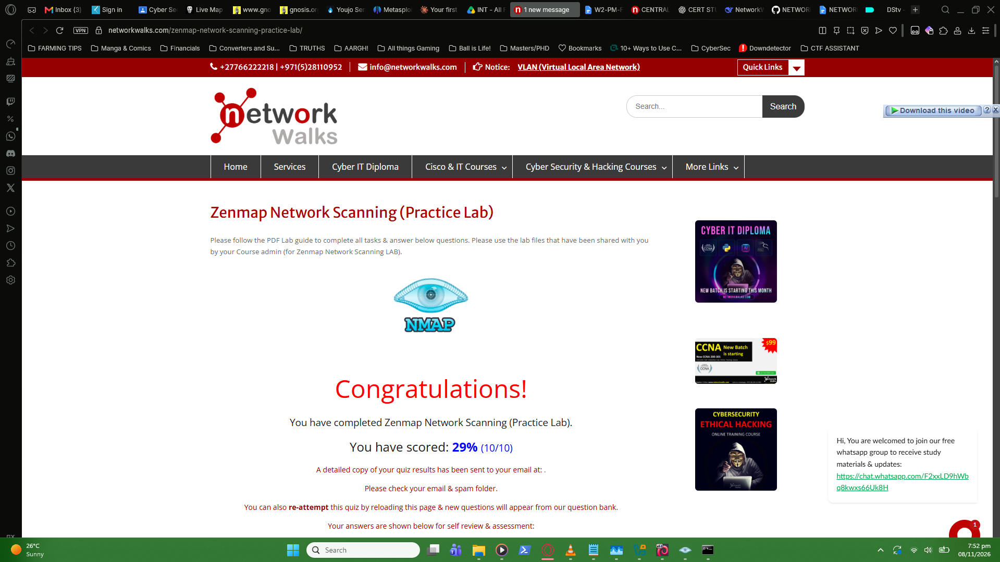

# Week 2 - Project Module 5: Network Scanning with Zenmap

## Overview
In this lab, I used **Zenmap**, the official GUI for Nmap, to perform network discovery and host enumeration on my local subnet. This module demonstrated how attackers (and defenders) map out live hosts and their associated hardware addresses.

## Lab Tasks Completed

### Task 1: Installation
* Downloaded and installed the latest version of Zenmap from the official Nmap website.

### Task 2: Find Local IP & Subnet
* **Command:** `ipconfig` in Windows CMD.
* Identified my local IP address and the LAN subnet mask to determine my target scan range.

### Task 3 & 4: Find Live Hosts (Ping Scan)
* **Zenmap Profile:** Ping Scan
* **Scan Results:** Discovered multiple live hosts on the subnet (including my own machine).
* **Screenshot:**
  

### Task 5 & 6: IP and MAC Addresses
* Extracted the IP addresses of the live hosts.
* Identified the corresponding MAC addresses to determine the hardware vendors (e.g., VMware virtual adapters vs physical hardware).

### Task 7: Topology Mapping
* Utilized the "Topology" tab in Zenmap to generate a visual map of the network.
* Saved the output as a PDF document.
* 📄 **[Click here to view the Network Topology PDF]("localtopology.pdf")

## Quiz Results
* Completed the practice lab quiz.
* **Final Score:** [Insert your highest score here, e.g., 100%]
* **Screenshot:**
  
